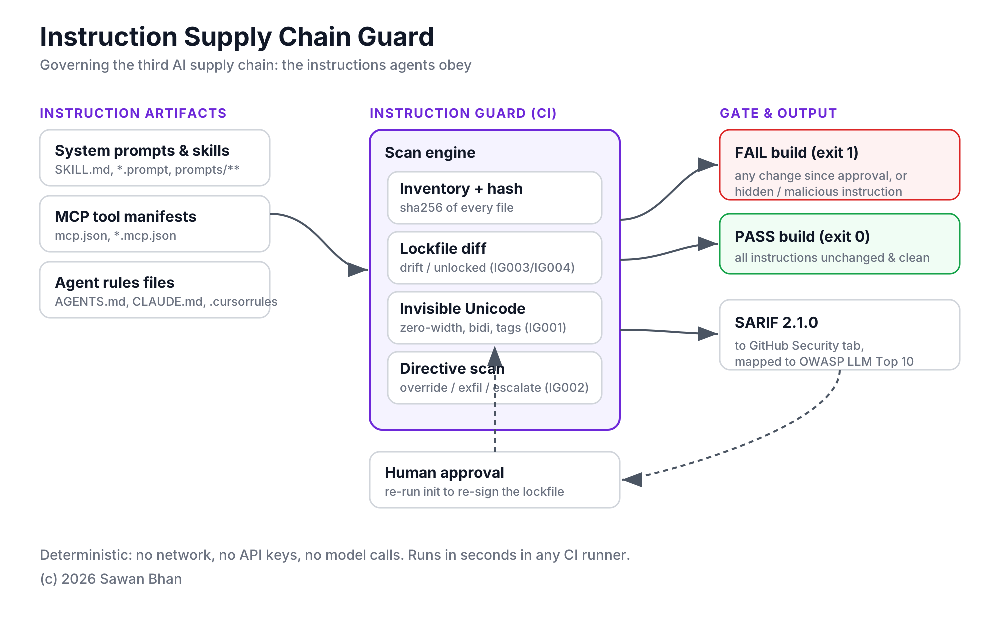

# Instruction Supply Chain Guard

> A lockfile and scanner for the instructions your AI agents obey.



SCA tools inventory your **code** and your **models**. Nothing governs the third
AI supply chain: the **instructions** - system prompts, agent skills, MCP tool
descriptions, and rules files (`AGENTS.md`, `CLAUDE.md`, `.cursorrules`). These
are pulled from third parties, change silently, and are never scanned. Attackers
already abuse them: hidden text in tool descriptions, invisible Unicode in rules
files, and MCP servers that quietly change a tool's description *after* you
approved it (a "rug pull").

Instruction Guard treats these artifacts like dependencies: it **inventories**
them, **scans** them, **locks** them, and fails your pipeline when any of them
**changes** without review.

## What it catches

| Rule | ID | Detects |
|------|----|---------|
| Drift | IG003 | A pinned instruction file changed since it was approved |
| Unlocked | IG004 | A new instruction file that was never reviewed |
| Invisible Unicode | IG001 | Zero-width, bidi-override, and Unicode-Tag smuggled text |
| Directive | IG002 | Injected override / escalation / concealment / exfiltration phrasing |

Findings map to the **OWASP LLM Top 10** (LLM01 Prompt Injection, LLM03 Supply
Chain) and export as **SARIF** for GitHub code scanning.

## Quick start

```bash
pip install instruction-guard

# 1. Approve the current state (writes instruction-guard.lock.json)
instruction-guard init

# 2. Gate every change
instruction-guard scan --fail-on high
```

Commit `instruction-guard.lock.json`. Any later change to a locked file, or any
new instruction file, fails the scan until a human re-runs `init` to re-approve.

## As a GitHub Action

```yaml
- uses: hackin2minutes-oss/instruction-guard@v1
  with:
    root: "."
    fail-on: "high"
```

See [`examples/demo-repo`](examples/demo-repo) for a working setup that contains
a **planted rug-pull attack** - the scan is meant to go red there.

## Signing: block, don't just detect (optional)

Drift detection tells you a file changed. Signing stops a changed file from
being trusted at all - even if an attacker also edits the lockfile to hide the
change, they cannot forge the signature without your private key.

```bash
pip install "instruction-guard[sign]"

instruction-guard keygen                 # one-time: writes a private key + .pub
instruction-guard sign                   # sign the approved lockfile
instruction-guard verify                 # gate: fails if the lockfile was altered
```

Commit the `.pub` and `.sig` files; keep the private key as a CI secret. Signing
uses offline Ed25519 - no network, no Fulcio/Rekor, no OIDC - so it works in
air-gapped pipelines. The core `scan` command needs none of this and stays
dependency-free.

## Why it's deterministic and safe for CI

No network, no API keys, no model calls. Same files in, same result out. It runs
in seconds and needs no secrets, so it's safe to drop into any pipeline.

## Files it scans by default

`AGENTS.md`, `CLAUDE.md`, `.cursorrules`, `.windsurfrules`, `*.mcp.json`,
`mcp.json`, `*.prompt` / `*.prompt.md`, `system_prompt*.md`, `prompts/**`,
`skills/**/SKILL.md`, `.github/copilot-instructions.md`.

## Roadmap

- Allowlist of approved MCP tool permission scopes
- Regional compliance mapping (NCA, SDAIA AI principles)
- Baseline suppression with expiry

## License

MIT (c) Sawan Bhan
